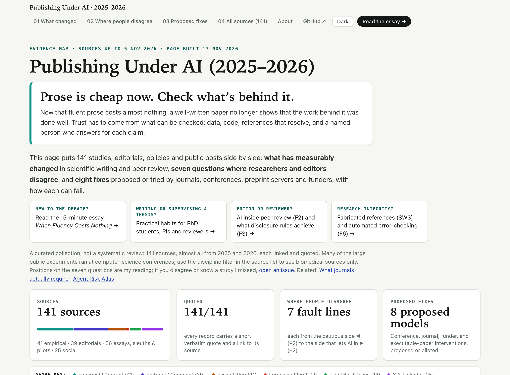

# Publishing Under AI (2025–2026)

**Prose is cheap now. Check what's behind it.**

Now that fluent prose costs almost nothing, a well-written paper no longer shows that the work behind it was done well. Trust has to come from what can be checked: data, code, references that resolve, and a named person who answers for each claim.

This project puts 141 studies, editorials, policies and public posts side by side: what has measurably changed in scientific writing and peer review in 2025–2026, seven questions where researchers and editors disagree, and eight fixes proposed or tried by journals, conferences, preprint servers and funders.

**[Open the map](https://michalie.github.io/publishing-under-ai/)** · **[Read the essay (15 min)](https://michalie.github.io/publishing-under-ai/essay.html)** · **[Data (records CC0)](https://michalie.github.io/publishing-under-ai/data.json)**



## Why this exists

If you write papers, review them, or advise PhD students right now, you hear opposite stories about AI in publishing almost every week. One cardiology journal tells authors they need not disclose AI used only to polish their writing, while a political-science journal and arXiv now cap how many papers one person can submit. One preprint finds language models catching more of the errors deliberately planted in clinical-trial reports than peer reviewers did in an earlier study; another shows that a hidden instruction in a manuscript can push AI reviewers toward recommending acceptance.

I put this project together to lay those studies, editorials, sleuth reports, and researcher threads side by side on one page, so you can see where thoughtful people disagree and what assumption each side relies on. It sits alongside two related pages: [What journals actually require](https://michalie.github.io/journal-ai-policies/) (verbatim publisher rules) and the [Agent Risk Atlas](https://michalie.github.io/agent-risk-atlas/) (how AI agents go wrong inside a research project before you submit).

## How to read it

The [map](https://michalie.github.io/publishing-under-ai/) is organized in four parts:

- **Eight measured shifts (`01` What changed):** what has changed in the numbers across drafting, citations, desk triage, peer review, post-publication checks, and autonomous-paper venues, with sample scopes and limits stated plainly.
- **Seven fault lines (`02` Where people disagree):** the core arguments where researchers and editors split. Each runs on a five-step scale from the more cautious side (`-2`, keep or tighten human control) to the side that lets AI in or opens up the system (`+2`). Click any name to read the summary and exact quote. A score of ±2 means the source argues for that side, ±1 that it leans that way or mainly supplies evidence for it, and 0 that it addresses the axis without taking a side. Each underlying claim is placed once: news reports and posts that echo an already-placed study, sources that do not address an axis, pseudonymous accounts, and casual posts by private individuals are listed in the ledger without a position. The placements are my reading; if yours differs, tell me.
- **Eight proposed models (`03` Proposed fixes):** concrete ideas proposed or piloted in 2025–2026 — from bounded "Reviewer 4" checks and rolling submission caps to runnable MCP papers and funder journal exits — together with where each one breaks or gets gamed.
- **Source ledger (`04` All sources):** all 141 records, filterable by stage, genre, discipline (`Biomed & Life Sci`, `CS & ML`, or cross-disciplinary), or fault line.

If you prefer a straight read first, the companion essay — [**When Fluency Costs Nothing**](https://michalie.github.io/publishing-under-ai/essay.html) (~15 minutes, written for researchers and PhD students) — walks through the main tensions and ends with practical Monday-morning habits for trainees, PIs, and editors.

## Where the sources come from

The dataset currently holds **141 sources**, almost all from 2025 and 2026, checked in November 2026: empirical studies and preprints, open and paywalled journal editorials, integrity-sleuth investigations, policy announcements, and public threads by editors and researchers on X and LinkedIn. It is a curated collection, not a systematic review, and the checks compare each record with its source; they do not replicate any study.

Every record links to a checked DOI, arXiv preprint, official policy page, or direct post URL, and includes a verbatim excerpt from the source text (one subscription-gated *Heart* opinion article is recorded from its public opening preview paragraph and marked accordingly).

If you wrote one of the pieces included here and think a summary misstates your view — or if we missed an important study or pilot — please [open an issue](https://github.com/MichaLie/publishing-under-ai/issues).

## How it was made

Maintained by [Michaela Liegertová](https://github.com/MichaLie) (Jan Evangelista Purkyně University in Ústí nad Labem; Institute of Molecular Genetics of the Czech Academy of Sciences). Created in collaboration with AI agents running Gemini Carbon, Claude Opus 5.5 and Fable 5.2.

## How to cite

Liegertová M. *Publishing Under AI (2025–2026)*. Version 1.1, 2026. https://michalie.github.io/publishing-under-ai/ (see `CITATION.cff`; changes between versions are listed in `CHANGELOG.md`).

## Licence

Records (summaries, positions, card text) CC0. Code MIT (see `LICENSE`). Quoted excerpts belong to their authors and publishers and are reproduced as short quotations for comparison and criticism, with attribution and a link to the source.

## Run locally

Python 3.10+ and `pyyaml`:

```bash
pip install -r requirements.txt
python3 tools/validate.py   # checks schema, IDs, URL form, excerpt presence, and essay citations
python3 tools/build.py      # builds docs/index.html, docs/essay.html, docs/essay.md, and docs/data.json
```

The generated files in `docs/` use no external CDNs and open directly in any browser.

## Layout

```text
content/essay.md         companion essay source with [[source-id|label]] citations
data/fault_lines.yml     the seven contested axes (F1–F7)
data/models.yml          the eight proposed models (M1–M8)
data/shockwaves.yml      the eight empirical shift cards (SW1–SW8)
data/sources.yml         141 source records with verbatim excerpts
tools/validate.py        schema, URL-form, excerpt-presence, and citation checks
tools/render_essay.py    renders content/essay.md to docs/essay.html and docs/essay.md
tools/build.py           computes counts/distributions and builds docs/
docs/                    GitHub Pages output (index.html, essay.html, essay.md, data.json, preview.png, social-card.png)
CITATION.cff             how to cite
CHANGELOG.md             what changed between versions
```
